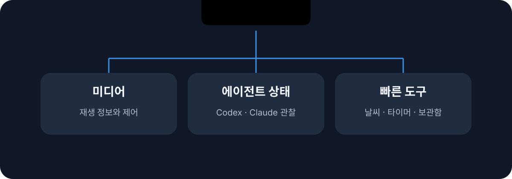

<p align="center"></p>
<h1 align="center">Rium Notch</h1>
<p align="center"><strong>macOS 노치에 담는 나만의 작업 공간</strong><br>음악, 에이전트 상태와 자주 쓰는 도구를 노치에서 만나는 오픈소스 앱</p>
<p align="center"><a href="https://github.com/contentriumkorea/rium-notch/releases"></a>  <a href="LICENSE"></a></p>
<p align="center"><a href="#빠르게-시작하기">빌드하기</a> · <a href="https://github.com/contentriumkorea/rium-notch/releases/latest">Mac 다운로드</a> · <a href="#사용-모습">사용 모습</a> · <a href="docs/BUILD.md">상세 안내</a></p>

---

## 빠르게 시작하기

[Mac용 DMG 다운로드 (Apple silicon) →](https://github.com/contentriumkorea/rium-notch/releases/latest)

macOS 14 이상의 Apple silicon Mac을 대상으로 한 미리보기입니다. DMG의 앱을 Applications 폴더에 복사하세요. **Apple Developer ID 서명과 공증이 없어 macOS가 다운로드한 앱의 실행을 차단할 수 있습니다.** 다른 Mac에서 설치와 실행은 검증하지 않았습니다.

직접 빌드하려면 Xcode Command Line Tools, Rust와 CMake가 필요합니다.

```sh
git clone https://github.com/contentriumkorea/rium-notch.git
cd rium-notch
zsh build.sh
open '../Rium Notch.app'
```

[빌드 및 업데이트 안내 →](docs/BUILD.md)

## 필요한 순간, 노치에서

| 01 · 노치 | 02 · 미디어와 에이전트 | 03 · 빠른 도구 |
| :--- | :--- | :--- |
| **작업 중에도 가까이** | **상태를 한눈에** | **자주 쓰는 기능을 한곳에** |
| 노치에 포인터를 올려 카드와 탭을 열고 홈 카드 표시와 탭 순서를 조정합니다. | 재생 정보와 Codex·Claude 활동을 확인합니다. | 날씨, 타이머, 클립보드와 파일 보관함을 사용합니다. |

## 사용 모습

<p align="center"></p>

**노치의 작은 공간에서 필요한 화면으로 확장합니다.**

위 이미지는 앱 화면을 재현한 스크린샷이 아니라 기능 구성도입니다.

<details><summary><strong>추가 기능</strong></summary>

일정, 받아쓰기, AirDrop 및 스크린샷 감시, 텔레프롬프터가 포함되어 있습니다. 일부 기능은 macOS 권한과 별도의 설정이 필요합니다.

</details>

## 제공 형태

| 방식 | 사용 방법 |
| :--- | :--- |
| macOS DMG | [최신 릴리스](https://github.com/contentriumkorea/rium-notch/releases/latest)에서 Apple silicon용 미리보기를 받습니다. 서명·공증되지 않았습니다. |
| 소스 빌드 | 이 저장소를 내려받아 직접 빌드합니다. |
| GitHub 릴리스 | 버전별 변경 내용과 미리보기 DMG를 제공합니다. 서명·공증된 설치 파일은 아직 제공하지 않습니다. |

## 이렇게 사용하세요

```text
노치에 포인터 올리기 → 원하는 탭 선택 → 설정에서 사용할 기능 조정
```

## 적용 범위와 제한

이 프로젝트는 개발 중이며 기능·디자인과 안정성이 계속 바뀝니다. 사용량 추적 기능과 일부 조명 스타일은 준비 중입니다. macOS 권한을 사용하는 기능, 다른 기기에서의 AirDrop, 다양한 화면 환경과 서명된 배포는 추가 검증이 필요합니다. 음악 제어는 macOS 비공개 MediaRemote 인터페이스를 사용하므로 OS 업데이트에 따라 동작이 달라질 수 있습니다. Codex·Claude 연동은 로컬 세션 정보를 읽으며 일부 상태는 기존 Glance 로컬 상태 파일을 참조할 수 있습니다.

Sparkle이 포함된 버전의 설정에서 **업데이트**를 누르면 GitHub에서 새 버전을 내려받아 프로젝트의 서명으로 검증한 뒤 앱을 교체하고 다시 엽니다. v0.2.1 이하에서 옮겨 올 때는 Sparkle이 포함된 첫 버전을 DMG로 설치합니다. 배포 조건과 네트워크 기능은 [상세 안내](docs/BUILD.md)를 참고하세요.

<details><summary><strong>English overview</strong></summary>

Rium Notch is an in-development macOS notch utility for Apple silicon. It includes media, agent status, quick tools and Sparkle updates signed by the project. The GitHub preview DMG is not notarized by Apple.

</details>

---
<p align="center"><strong>CONTENTRIUM</strong><br><a href="LICENSE">MIT License</a> · <a href="https://github.com/contentriumkorea/rium-notch/releases">Latest release</a></p>
<sub>타사 구성요소에는 별도 라이선스가 적용됩니다. 자세한 내용은 <a href="THIRD_PARTY_NOTICES.md">고지</a>를 참조하세요. Glance 및 다른 제품의 상표는 각 소유자에게 속합니다.</sub>
<p align="center"><a href="https://contentrium.com/"></a></p>
